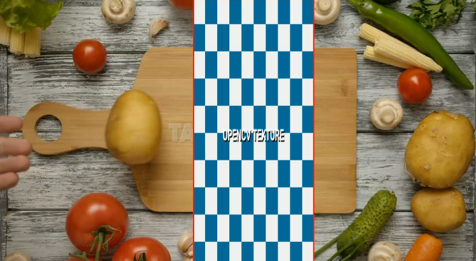
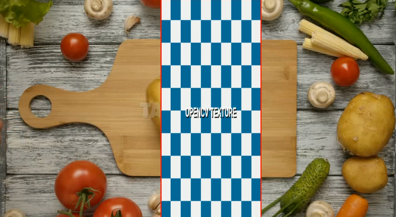

# CS6524: Computer Vision — Lab 4: Optical Flow and Kalman Filters

**Immersive Software Engineering (ISE) — University of Limerick**  

**Instructor:** Juan Albarracín [✉️](mailto:Juan.Albarracin@ul.ie)\
**Teacher Assistant:** Thendral Balakrishnan [✉️](mailto:balakrishnan.thendral@ul.ie)\
**Module Lead:** James Patten [✉️](mailto:James.Patten@ul.ie)

**Deadline:** Sunday, November 22th at Midnight (Autumn Semester Week 4)

---

## 🎯 Objective

Learn how to model the motion from a target object in an image and how to track it when it is out of the scene.

---

## 📌 Context

Optical flow can measure the position and velocity of pixels/keypoints at a given time, whereas Kalman Filters can model how those measurements can be used to predict a future position and velocity of the target. In this laboratory, you will design a framework that tracks a moving object and predicts its position even when the objects get occluded. There are more than one way to model the motion of the object, and you will be free to choice the many parameters of the Kalman Filter, as long as you reach a good prediction level, and can justify your choices in the report. 

---

## 🔄 Step-by-Step Guide

### 1. No need to record videos

This time three videos will be provided. They consist of a moving object with a very simple linear trajectory that get artificially occluded at a specific location.

However,

### 🎁 Bonus (+0.2 Grade Point)

If you record you own video with a real object trajectory and a real-world occlusion (not the unimaginative square I put on the test videos), you'll get extra points.

### 2. Optical Flow (OF)

- Use OpenCv's Lucas-Kanade method implementation (`cv.calcOpticalFlowPyrLK`) to calculate optical flow.
- [Hint] You can use `cv.goodFeaturesToTrack`, which will spare you of having to choose which keypoints to track.
- For every frame, get a position and velocity estimation of the keypoints.
    - Instead of using realistic units like centimeters and seconds, you can model everything with something more objective like `pixels` per `frame`.

### 3. Design your Kalman Filter

- When in doubt, follow the concepts and logic in [the tutorial](https://kalmanfilter.net/).
- You definitely need to model and correct for the position. However, you can measure velocity so you can correct also for velocity. This is totally up to you.
- The state transition matrix $F$ needs to be declared according to the decision you made above.
- No control input foreseen, so you will probably disregard $G$.
- What about $P$? It will probably be diagonal, but the values in the diagonal can come either from a value you fix or, more interestingly, the standard deviation of your position/velocity measures, which can be obtained form the OF. 
- $Q$ is definitely something you can fix following your intuition, or by trial-error.
- From this point, `cv2.KalmanFilter` can do the rest of the heavy work, but you're encouraged to see what is going on inside, particularly, with $K$.

### 4. Track the object

- Whenever you have position/speed measurements, you can feed the filter with new evidence.
- Once the object is not trackable anymore, you will have to rely only on the filters predictions.
- Once the object is back, compare the prediction of the filter with the new measurement.
    - You can assess it visually and discuss the mismatch on the report, or
    - You also can devise an simple error metric
- ⚠️ **Split trajectories:** Now, calculate two trajectories:
    1. The trajectory of the potato now that it is back.
    2. The trajectory that the filter would keep doing if the potato was not back.

### 5. Plot the process

- You decide what to track:
    - A specific point of interest of the object?
    - The *centroid* of the object?
- Whatever you decide to track, you need to plot it on the video
    - Plot with different colors when you are receiving a measurement from when you are merely predicting, as well as the two trajectories after the object is back.

### 6. Discussion

- Your report must include a discussion about all the decisions took to solve the problem:
    - How you configured the LK method?
    - What exactly you decided to track in representation of the object?
    - Did you include velocity in your model? Why you did/did not?
    - How did you model the process and measurement noises? Why?
- If relevant, you can include snapshots of failed attempts, explaining why it failed and how you solved it.

---

## 📋 Submission Guidelines and Rules

### 1. Repository Setup and Student Identification
- **Forking Requirement:** You must fork the official starter repository into your own GitHub account or team space.
- **Repository Naming Convention:** Rename your forked repository to: `cs6524-lab4-group<XX>`
    - If you work alone (only because you did not attend the session), you can rename it to: `cs6524-lab4-<Student ID>`
- **Identification (`TEAM.md`):** Add a `TEAM.md` file in the repository root with the full names, student IDs, and GitHub usernames of all team members before making your final push.

### 2. Code Structure and Execution
- **Main Entry Point:** All execution must be triggered by running `python main.py` in the repository root without any command-line arguments.
- **Custom Modules:** Any additional helper scripts or custom functions must be placed inside the `mypylibs/` directory.
- **Allowed and Prohibited Libraries:** All the libraries present in the docker image are allowed, without any function restriction. The image for this lab has OpenCV.

### 3. Input Specifications (`in/`)
- Three wideos will be provided (`0[1-3].mp4`)
- **Optional Configuration:** Should you require custom configuration, include the corresponding config files (`0[1-3].yaml`)
- If you opt for the bonus, `04.mp4`, and remember to keep it below 5MB.

### 4. Output Specifications (`out/`)

For each input video:

- `XX_of.mp4`: A video depicting the OF of the scene.
- `XX_tr.pm4`: A video showing the trajectories of the object of interest:
    1. The measured (from OF)
    2. The predicted one
    3. The corrected one (if available)
    4. The uncorrected one after the object reappears (what if it would not have reappeared?)
- If you track velocity, plot the vectors every $n$ frames, for visualization purposes.

⚠️ Do your best about visualization clarity, as you'll have to plot many things.

### 5. Written Report and Assets (`report.tex` and `assets/latex/`)
- *File Location and Template:* Write your report in `report.tex` in the repository root, using the provided IEEE Transactions LaTeX template.
- **Report Assets (`assets/latex/`):** Place all figures, sub-diagrams, and external files needed for your LaTeX report inside the `assets/latex/` directory to keep the root directory tidy.
- **Length Limit:** Maximum 3 pages (including figures and references).
- **Required Content:**
    - **Methodology:** Concise description of the whole pipeline with particular considerations you find necessary to add.
    - **Discussion and Failure Analysis:** Critical analysis of the results, whether the pipeline succeeded or failed, along with concrete steps for improvement if given more time.
- **Writing Quality and Authenticity:** Be brief, rigorous, and specific. Your analysis must convince the reader that you personally conducted the experiments, understood the mathematical trade-offs, and derived the insights yourself. Avoid pasting generic, boilerplate text from LLMs—reports that read like unverified AI summaries will be flagged and incur heavy grade deductions.

### 6. CI/CD Pipeline, Local Testing and Bonus Point
- **Automated Workflow:** GitHub Actions will execute `main.py` and compile `report.tex` into `report.pdf` upon pushing to `main`.
- **Local Docker Testing:** It is strongly recommended to test your code locally using the provided Docker environment before pushing to ensure pipeline compatibility.
